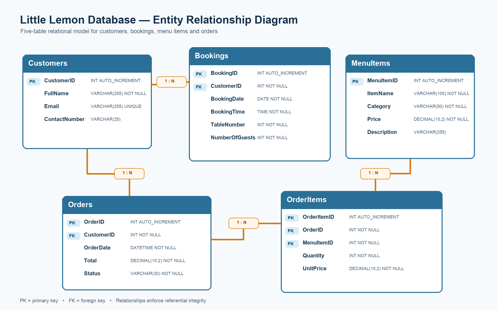
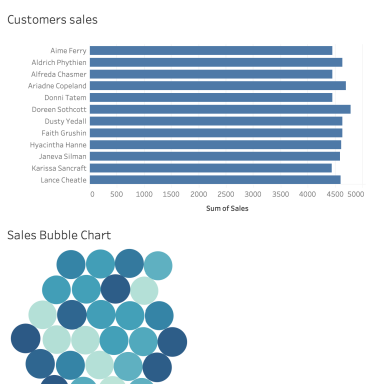

# Little Lemon Database Capstone

Proyecto reproducible para el curso **Database Engineer Capstone** de Meta. Incluye el modelo relacional, el esquema MySQL, consultas y procedimientos almacenados, un cliente de Python y el análisis solicitado en Tableau.

## Entregables finales

- [`LittleLemonDB_Model.mwb`](LittleLemonDB_Model.mwb): modelo editable de MySQL Workbench.
- [`diagrams/little_lemon_erd.png`](diagrams/little_lemon_erd.png): diagrama ER con cinco tablas y cuatro relaciones.
- [`sql/01_schema.sql`](sql/01_schema.sql): creación reproducible de la base, tablas, restricciones, índices y datos de prueba.
- [`sql/02_queries_and_procedures.sql`](sql/02_queries_and_procedures.sql): vista, consultas, sentencia preparada y cinco procedimientos almacenados.
- [`python/database_client.py`](python/database_client.py): cliente de línea de comandos sin credenciales incrustadas.
- [`tableau/LittleLemon_Tableau_Dashboard.twbx`](tableau/LittleLemon_Tableau_Dashboard.twbx): workbook empaquetado y portátil de Tableau.
- [`diagrams/little_lemon_sales_dashboard.png`](diagrams/little_lemon_sales_dashboard.png): evidencia del dashboard interactivo.
- [`VALIDATION.md`](VALIDATION.md): pruebas realizadas y sus resultados.

Los archivos con el sufijo `_template` se conservan únicamente como referencia de aprendizaje. Los archivos sin ese sufijo son los entregables terminados.

## Modelo relacional

El esquema usa las tablas `Customers`, `Bookings`, `MenuItems`, `Orders` y `OrderItems`. Las reservas y los pedidos pertenecen a un cliente; cada detalle de pedido enlaza un pedido con un elemento del menú. Las claves foráneas, restricciones de integridad e índices están definidos tanto en el modelo como en el SQL.



## Cómo reproducir la base

1. Abre MySQL Workbench y conéctate a MySQL 8.
2. Ejecuta [`sql/01_schema.sql`](sql/01_schema.sql).
3. Ejecuta [`sql/02_queries_and_procedures.sql`](sql/02_queries_and_procedures.sql).
4. Revisa las consultas de verificación y las llamadas a los cinco procedimientos al final de los archivos.

El primer script es repetible: vuelve a crear las tablas dentro de `LittleLemonDB` y carga un conjunto pequeño de datos sintéticos para probar el proyecto.

## Cliente de Python

Instala la dependencia:

```bash
python3 -m pip install -r python/requirements.txt
```

Configura la conexión mediante variables de entorno; no escribas la contraseña en el código:

```bash
export MYSQL_USER="root"
export MYSQL_PASSWORD="tu_contraseña"
export MYSQL_HOST="127.0.0.1"
export MYSQL_PORT="3306"
export MYSQL_DATABASE="LittleLemonDB"
```

Ejemplos:

```bash
python3 python/database_client.py tables
python3 python/database_client.py orders 1
python3 python/database_client.py call GetMaxQuantity
python3 python/database_client.py call ManageBooking 2026-10-10 5
```

## Tableau

El workbook contiene las cuatro hojas solicitadas:

1. `Customers sales`: ventas por cliente con filtro de ventas de al menos 70.
2. `Profit chart`: beneficio de 2019 a 2022, excluyendo 2023.
3. `Sales Bubble Chart`: comparación visual de ventas y beneficios por cliente.
4. `Cuisine Sales and Profits`: ventas y beneficios de las cocinas griega, turca e italiana entre 2020 y 2022.

El dashboard `Little Lemon Sales Dashboard` combina `Customers sales` y `Sales Bubble Chart`. Seleccionar una barra filtra las burbujas; la acción fue comprobada y quedó guardada en el workbook.



## Seguridad y entrega

- El repositorio no debe contener `.env`, contraseñas, tokens ni copias de respaldo.
- El archivo oficial de datos se conserva localmente y está excluido de Git para evitar redistribuirlo sin autorización.
- La entrega final en Coursera, la declaración de autoría y el botón **Submit** deben ser revisados y completados personalmente por el estudiante.
